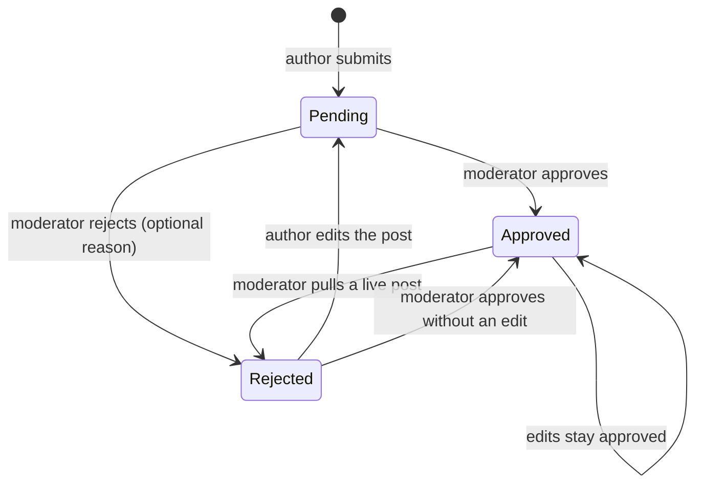

# Moderation

**Who:** moderators and admins review posts and comments; authors receive the decisions. **Entry points:** "Review Queue" (`/dashboard/admin/posts`), "All Posts" (`/dashboard/admin/all-posts`, admins), "Comments" (`/dashboard/admin/comments`), the "post waiting for review" notification.

## How it works

A post's `approval` is Pending, Approved or Rejected. Private posts (see [writing.md](writing.md) › "Keep a post private") never reach moderation: they aren't listed, can't be opened, approved, edited or deleted by staff, and making a waiting post private marks its review notifications read. Submitting or resubmitting a post notifies every moderator and admin (`notifyPostSubmitted()` in `src/libs/review-notifications.ts`); a decision through `PATCH /api/posts/[slug]/approval` notifies the author and marks the staff's review notifications for that post as read, so the bell doesn't keep showing handled work. Approval publishes the post at the later of the approval and the author's scheduled time.

## Flows

### 1. Approve a post

**Preconditions:** a pending post; signed in as moderator or admin.

1. Opens the notification or the review queue. → The pending post with its author.
2. Approves it. → It leaves the queue and is public (or scheduled).

**Side effects:** the author gets "approved" (in-app and push per their preferences); staff review notifications for the post are marked read.

**Tested by:** `e2e/publishing.spec.ts` › "an author's post goes live only after a moderator approves it".

### 2. Reject with a reason, and resubmit

1. Rejects the post, optionally writing why. → It leaves the queue.
2. The author opens the rejection notification. → The edit page, with a banner showing the reason.
3. The author edits and saves. → The post is "Pending" again, the reason is cleared, and moderators are notified again.

**Extensions:**

- 1a. A reason over 1000 characters: refused with the limit.
- 3a. An admin editing someone else's rejected post: it stays rejected (only the author's edit resubmits).

**Extensions (any state):** a moderator can decide again at any time: rejecting an approved post takes it off the site, approving a rejected one publishes it; the author is notified either way.

**Tested by:** `e2e/moderation.spec.ts` › "a rejected post carries the moderator's reason, and the author's edit sends it back for review".

### 3. Moderate comments

1. Opens "Comments". → Every comment, newest first, with author and post, searchable and paged.
2. Removes one and confirms. → On the post it disappears, or shows as a "[deleted]" placeholder if it has replies, so they keep their thread; the post's comment count drops.

**Tested by:** `e2e/admin.spec.ts` › "an admin searches comments, pages through them and removes one after confirming".

## Rules and limits

- Review queue and comment moderation: moderators and above. All Posts: admins (`src/proxy.ts` role gates; the APIs check the same roles).
- Rejection reason: up to 1000 characters, shown only to the author and staff.
